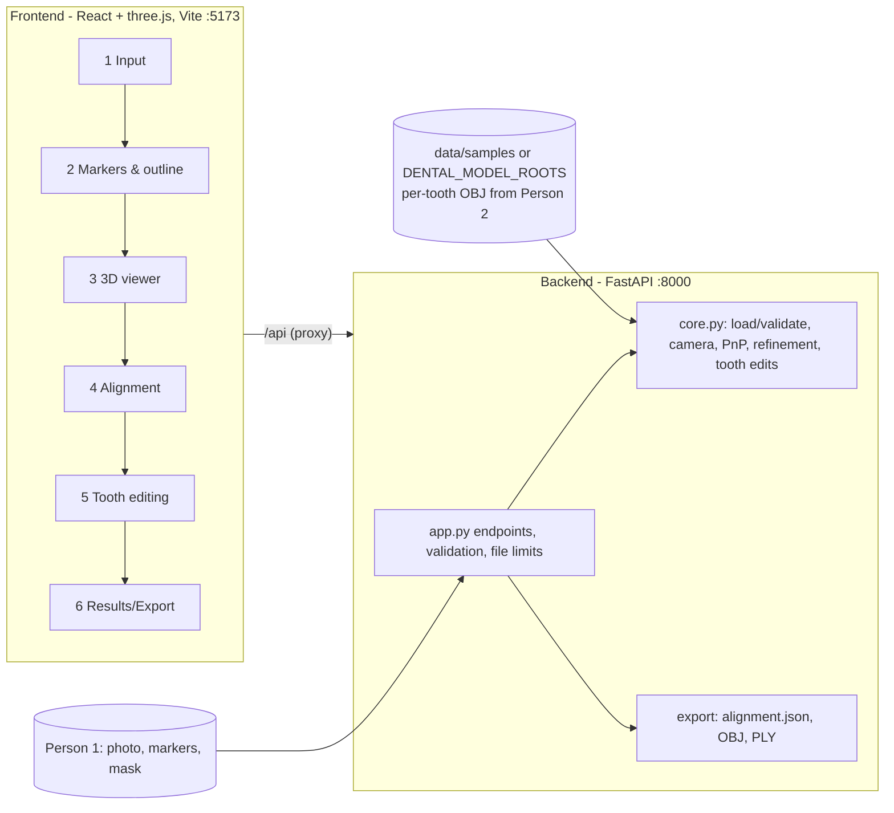
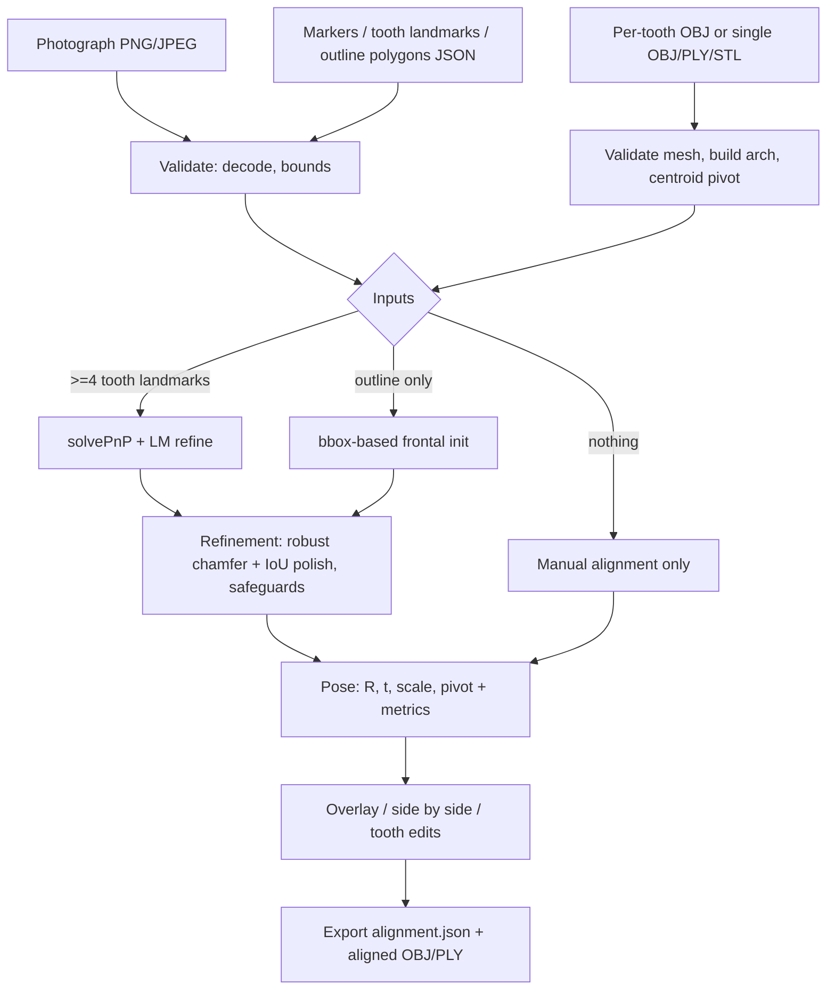

# 2D dental photograph ↔ 3D dental model alignment (research prototype)

Fit a 3D dental arch template to a frontal photograph of the teeth, view the two together, refine by hand, and export the
alignment. **The 3D model is a template/prior. One photograph cannot determine a patient's real tooth geometry, so results
are "fitted/estimated", never a reconstruction of the patient's anatomy, and nothing here is for diagnosis or treatment.**

> **New: [versions/v1](versions/v1/README.md)** — automated smile-simulation demo (Photo A + Photo B, automatic model selection, 3D editing with versions, Photo B simulation, export) and Render / Vercel deployment. The rest of this README documents the underlying registration workbench.

## What was found when inspecting the inputs (read this first)

| Input | Finding |
|---|---|
| **Person 2 repo** (`thistushar24/VITA-3D-Master-Shade-System-…`) | Contains **no VITA shade system, no frontend, no backend, no code**. It is 300 processed **Teeth3DS** cases (150 upper, 150 lower) as per-tooth OBJ files `tooth_<FDI>.obj` + `metadata.json`, in **millimetres**, in the original scanner frame (teeth not re-centred, so arch layout is preserved). There is therefore nothing to preserve or reuse from a shade system; this repo had only a placeholder empty README, now replaced by this file. Person 2's notes are in `PERSON2_README.md`. |
| Person 2 OBJ storage | The `.obj` files are **Git LFS pointers**. Without `git lfs pull` they are 130-byte text stubs (the loader detects this and says so). Real meshes: upper arches ≈ 12 teeth / 22k faces, lower ≈ 13 teeth / ~100k faces (one case checked). |
| **Person 1 data** (Google Drive "Person1" folder) | **Not inspected.** The folder exists, but its contents were not visible to the tools used here, so it is unknown whether it holds dental photos, markers, masks or camera data, and it was never confirmed to be (or not be) a dental dataset. Nothing from it was fabricated or assumed. Instead the system defines the Person 1 → Person 3 contract (`docs/DATA_CONTRACT.md`) and a **manual annotation fallback** (click markers, tooth landmarks, outline). If the Drive data turns out not to be dental, use a different photo source; the pipeline does not care where the photo comes from. |
| Full-arch model | Not provided as a single mesh, but each arch is rebuilt by merging the per-tooth files (FDI-labelled), so **individual-tooth editing is available**. Uploaded single OBJ/PLY/STL meshes are also accepted (tooth editing is then disabled, with a message). |
| Licensing | Teeth3DS is **CC BY-NC-ND 4.0** (verified on the dataset page): no derivatives. Derived meshes are therefore **not committed** here; the published demo uses original procedurally generated arches. See [docs/ASSETS_AND_LICENSES.md](docs/ASSETS_AND_LICENSES.md). |
| Real photos | None available to me. Everything was verified on a **synthetic** photo rendered from the model at a known pose. **No test has used a real dental photograph, so real-photo accuracy is unknown.** |

## Architecture





## Setup and run

Requirements: Python ≥ 3.10, Node ≥ 18. No GPU.

```bash
# backend (from repo root)
python3 -m venv .venv && .venv/bin/pip install -r backend/requirements.txt
cd backend && ../.venv/bin/uvicorn dental_reg.app:app --port 8000

# frontend (second terminal)
cd frontend && npm install && npm run dev      # http://localhost:5173
```

Then open the UI and press **Load synthetic demo**, or upload your own photo.
Real Person 2 meshes: `git lfs install && git lfs pull`, then
`DENTAL_MODEL_ROOTS=/path/to/processed_part1_upper:/path/to/processed_part1_lower` (path-list; each root's sub-folders are
cases). Other env vars: `DENTAL_STORAGE`, `DENTAL_MAX_IMAGE_MB` (20), `DENTAL_MAX_MESH_MB` (100), `DENTAL_CORS`.
Uploads/exports live in `backend/storage/` and are deleted after 24 h on the next server start; originals are never modified.

### Tests

```bash
cd backend && ../.venv/bin/python -m pytest -q      # backend tests (registration, library, matching, v1 API)
cd frontend && npx vitest run                       # 5 frontend geometry tests
cd backend && ../.venv/bin/python make_samples.py   # regenerate the synthetic sample files
```

## Using it

1. **Input**: upload a PNG/JPEG, pick a model (or upload OBJ/PLY/STL), set the approximate field of view. No calibration
   exists, so an *approximate pinhole camera* is used and labelled so everywhere. A calibrated `K` can be passed to the API.
2. **Markers & boundaries**: choose a tool and click on the photo. *Tooth landmark* = click the centre of a labelled tooth
   (FDI) → a genuine 3D↔2D correspondence (the tooth's centroid in the model). *Reference marker* = recorded only (a marker
   alone gives neither absolute scale nor pose; the physical 3D arrangement would be needed). *Tooth region outline* = polygon
   used as the tooth mask. Overlays can be toggled. Annotations are sent to the backend as JSON.
3. **3D viewer**: orbit/pan/zoom/reset, wireframe, optional second arch shown side by side (**no occlusion is implied**).
4. **Alignment**: opacity, move X/Y/depth, tilt/turn/roll, scale, reset, side-by-side/overlay, **Run automatic alignment**,
   **Save**. Manual mode always works, even if automatic alignment fails or has no inputs.
5. **Tooth editing** (only for per-tooth models): select an FDI tooth (highlighted), move (mm) and rotate (°, about its
   centre), reset. Neighbouring teeth are not pushed aside.
6. **Results**: status, mode (auto/manual), approximate-camera warning, the metrics that are computable, export JSON/OBJ/PLY,
   reload a saved alignment JSON.

### How automatic alignment works (`backend/dental_reg/core.py`)

- **≥4 tooth landmarks** → `cv2.solvePnP` (EPnP then iterative LM) on the tooth centroids, requiring non-degenerate points.
  With the approximate camera this is exact only to the degree the FOV guess is right.
- **Mask only** → frontal reference pose, scaled/centred from the mask bounding box.
- **Refinement** (when a mask exists): `scipy.optimize.least_squares` with robust `soft_l1` loss on (a) landmark
  reprojection, (b) visible-model-points→mask distance, (c) mask-boundary→model distance, plus a log-scale prior; then a
  derivative-free Powell polish of silhouette IoU at 320 px and 640 px. Explicit/configurable via `RegConfig`
  (`/auto` body `config`).
- **Safeguards**: bounded rotation (±35° default), bounded scale (0.8–1.25, fixed to 1 by default because perspective makes
  scale/depth near-degenerate), depth limits, behind-camera and back-face handling, pose validation, and **the refined pose is
  rejected if it does not improve the primary metric**. Status `poor_match` is reported when IoU < 0.5. Nothing silently
  falls back: the method used (`pnp` / `mask_bbox` / `manual`) and notes are always returned.
- Silhouette agreement does **not** imply correct 3D anatomy: many 3D configurations project alike.

## Limitations

- Registration was verified on synthetic data and one real photo (see versions/v1/README.md); real photo behaviour (lighting, gingiva, lip occlusion, lens distortion) is unmeasured.
- Rotation about the vertical/optical axes from the silhouette alone is weakly constrained for real, imperfect masks; expect
  to refine manually. Metrics compare against *your annotations*, not ground truth.
- Approximate camera by default; no automatic marker detection, no automatic tooth segmentation, no lens-distortion model,
  no OpenCV calibration UI (calibrated `K` can be supplied via the API; a calibration helper from chessboard images was not built).
- Reference markers are stored but do not constrain pose unless a physical 3D marker layout is added (not implemented).
- The template arch is not the patient's arch; no deformation to fit individual anatomy; upper/lower relation is not inferred.
- Default frontal reference rotation (`R_FRONT`) assumes Teeth3DS axes (−y = labial, −z = up); verified visually on one upper
  and one lower arch only. Other meshes may need a manual rotation.
- Single in-memory state, no auth, no database (restart loses sessions; exports persist on disk 24 h).
- Frontend lacks automated component/E2E tests (only geometry unit tests); the UI flow was exercised manually in a browser.
- Wireframe/surface rendering in the alignment canvas is a 2D painter's-algorithm approximation (fine for ~12k faces).

## Troubleshooting

- *"is a Git LFS pointer"*: run `git lfs pull` in the Person 2 repo.
- *Frontend shows API errors*: backend must run on :8000 (Vite proxies `/api`).
- *"automatic alignment needs a tooth mask/contour or ≥4 tooth landmarks"*: annotate in step 2, or align manually.
- *Model looks upside-down/mirrored*: rotate 180° with Tilt/Roll, or check the model's axes against `docs/DATA_CONTRACT.md`.

## Files added (nothing from Person 2 was modified)

`backend/dental_reg/{core,app,synth}.py`, `backend/{make_samples.py,requirements.txt,pytest.ini}`, `backend/tests/test_all.py`,
`frontend/{package.json,vite.config.js,index.html}`, `frontend/src/{App.jsx,Viewer.jsx,api.js,geom.js,geom.test.js,main.jsx,styles.css}`,
`data/samples/{proc_upper_01,synthetic_*,demo_*}`, `docs/DATA_CONTRACT.md`, `README.md`, `.gitignore`/`.gitattributes` (appended); v1: `versions/v1/`, `backend/dental_reg/{vision,match,library,v1}.py`, `backend/build_library.py`, `data/demo_library/`, `backend/{build_demo_library,bench_canines}.py`, `dental_reg/procedural.py`, `docs/ASSETS_AND_LICENSES.md`, `Dockerfile`, `render.yaml`, `.env.example`.

Docs: [data contract, JSON schema and API](docs/DATA_CONTRACT.md).

## Publishing
`main` is Person 2's repository. This work lives on `feature/v1-smile-simulation` (commit `97034e0`, **contains Teeth3DS-derived files in
its history - do not push that branch**) and the licence-clean branch `release/v1-clean` (single commit on top of `main`, no derived assets).
Push `release/v1-clean`. Write access to `thistushar24/VITA-3D-…` is required; the account used during development had read-only access.
